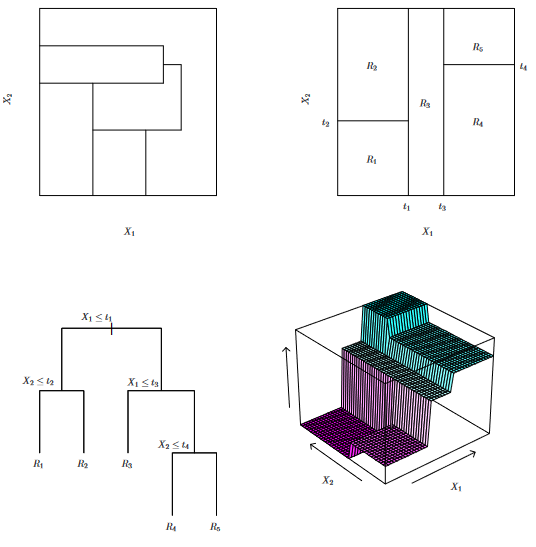

## Required Reading

- This page.

### Guiding Questions

- What is *shrinkage*?
- What do we do with too many right-hand-side variables?
- What is LASSO?

# This week is a little different
We will use the lecture slides from my friend and ace economist, Ed Rubin (U of Oregon). We go through them in three parts. After each part, we stop and try it on the Chicago Airbnb data from last week. At the end, we run Tuesday's simulation on this data.

## The data and packages

Dr. Rubin's examples use the `Credit` data from the `ISLR` package. You do not need it. We use the Airbnb listings again, with 48 new columns. Each new column is 1 if the listing has that amenity and 0 if it does not: a hot tub, a gym, a lake view, an EV charger, a piano. That gives us 60 predictors.

You need the `glmnet` package. It is new for us.

```{r, eval=F}
library(glmnet)

airbnb = read.csv('https://ec242.netlify.app/data/airbnb_chicago_amenities.csv')
```

```{r, echo=F, include=F}
library(glmnet)

airbnb = read.csv(here('data/airbnb_chicago_amenities.csv'))
```

Shrinkage helps most when we have many predictors and few observations. So we train on only 300 listings and test on the rest.

`glmnet` does not take a formula. It takes a matrix of predictors, `x`, and a vector for the outcome, `y`.

```{r}
set.seed(242)
train_idx = sample(nrow(airbnb), 300)
train = airbnb[train_idx, ]
test  = airbnb[-train_idx, ]

x_train = train %>% dplyr::select(-price) %>% as.matrix()
y_train = train$price
x_test  = test %>% dplyr::select(-price) %>% as.matrix()

lambdas = 10^seq(3, -1, length = 100)
```

## Is a piano worth $173 a night?

Start with plain OLS on the 300 training listings. `glmnet` with `lambda = 0` is OLS.

```{r}
ols = glmnet(x_train, y_train, lambda = 0)
```

Here are the five amenities with the largest OLS coefficients.

```{r, echo=F}
amenities = names(airbnb)[which(names(airbnb) == "host_listings") + 1:48]
ols_b = as.matrix(coef(ols))[amenities, 1]
data.frame(Amenity = gsub("_", " ", amenities),
           b = ols_b,
           n = colSums(x_train[, amenities])) %>%
  slice_max(abs(b), n = 5) %>%
  mutate(b = scales::dollar(round(b), style_negative = "minus")) %>%
  knitr::kable(col.names = c("Amenity", "OLS coefficient (per night)", "Listings in the 300 that have it"),
               align = "lrr", row.names = FALSE)
```

Do you believe a piano adds $173 a night? How many pianos did OLS see?

OLS believes every coefficient. It cannot say "I am not sure." Shrinkage gives it a way to say that.

::: {.callout-tip}
## The idea

Think of $\lambda$ as how skeptical the model is.

- At $\lambda = 0$, the model believes everything. That is OLS.
- As $\lambda$ grows, every coefficient must pay a penalty. A coefficient stays large only if it improves the fit by more than it costs.
- **Ridge** charges the *square* of each coefficient. A small coefficient costs almost nothing. So ridge shrinks every coefficient, but it keeps them all.
- **Lasso** charges the *size* of each coefficient. Every dollar of coefficient costs the same. So a weak coefficient is cheaper to drop. The lasso sets it to exactly zero.
- At a very large $\lambda$, every coefficient is zero. The model predicts the average price for every listing.

Five pianos is weak evidence. A skeptical model should not believe it.
:::

## Terminology
I used to have this lecture at the end of our semester, but I think the intuition behind LASSO and ridge regression helps understand our "overfitting" problem. There are two terms I want to cover before we dive into the slides:

1. **Bias vs. Variance**: We saw that super-overfit polynomial a couple weeks ago (where we took 20 observations and fit a 16th-degree polynomial). The model we fit was very flexible and bendy, but it did get most of the data points right. It had low *bias* as it was generally right, but had huge *variance* -- it was all over the place, even within a small range of advertising mode spending. **Bias vs. variance** refers to the innate tradeoff between these two things. When we used the train and test samples to get the best *out* of sample fit, we were balancing bias and variance.

2. **Cross validation**: This is the term for splitting your sample into two (or more) different subsets (e.g. train and test), fitting the model on one and checking how it does on the other -- and then rotating, so every chunk of the data gets a turn being held out.

## Part 1: Ridge

Go through the slides from [**Shrinkage methods**](https://raw.githack.com/edrubin/EC524W20/master/lecture/005/005-slides.html#shrinkage-intro) to the start of the Lasso section.

Now fit a ridge regression on the training data. `alpha = 0` makes it ridge. `glmnet` standardizes the predictors for you.

```{r}
ridge = glmnet(x_train, y_train, alpha = 0, lambda = lambdas)
```

::: {.callout-note}
## TRY IT

- Run `plot(ridge, xvar = "lambda")`. Each line is one coefficient. What happens to the coefficients as $\lambda$ grows?
- Does any coefficient reach exactly zero?
:::

## Part 2: Lasso

Go through the slides from [**Lasso**](https://raw.githack.com/edrubin/EC524W20/master/lecture/005/005-slides.html#lasso) to the start of the "Ridge or lasso?" section.

`alpha = 1` makes it a lasso.

```{r}
lasso = glmnet(x_train, y_train, alpha = 1, lambda = lambdas)
```

Here are both models on the same 300 listings. The five colored lines are the largest lasso coefficients. All coefficients are on a standardized scale, so we can compare them.

```{r, echo=F, fig.width=9, fig.height=4.5}
sdx = apply(x_train, 2, sd)
coef_path = function(fit, model_name) {
  b = as.matrix(coef(fit))[-1, ] * sdx
  as.data.frame(t(b)) %>%
    mutate(lambda = fit$lambda) %>%
    tidyr::pivot_longer(-lambda) %>%
    mutate(model = model_name)
}
paths = bind_rows(coef_path(ridge, "Ridge"), coef_path(lasso, "Lasso")) %>%
  mutate(model = factor(model, levels = c("Ridge", "Lasso")))
top5 = paths %>%
  filter(model == "Lasso") %>%
  group_by(name) %>%
  summarize(biggest = max(abs(value))) %>%
  slice_max(biggest, n = 5) %>%
  pull(name)

ggplot(paths, aes(x = lambda, y = value, group = name)) +
  geom_hline(yintercept = 0, color = "grey60") +
  geom_line(data = paths %>% filter(!name %in% top5), color = "grey80", linewidth = .4) +
  geom_line(data = paths %>% filter(name %in% top5), aes(color = name), linewidth = 1) +
  scale_x_log10(labels = scales::label_number(big.mark = ",", drop0trailing = TRUE)) +
  facet_wrap(~model) +
  labs(x = expression(lambda), y = "Coefficient (standardized)", color = NULL) +
  theme_minimal(base_size = 13) +
  theme(legend.position = "bottom", panel.grid.minor = element_blank())
```

::: {.callout-note}
## TRY IT

- Compare the two panels. What does the lasso do that ridge does not?
- Which coefficient lasts the longest in the lasso?
- The `ev_charger` coefficient is negative. Why would an EV charger go with a lower price?
:::

## Part 3: Choosing $\lambda$

Go through the slides from [**Ridge or lasso?**](https://raw.githack.com/edrubin/EC524W20/master/lecture/005/005-slides.html#or) to the end.

`cv.glmnet` does the cross-validation for you. It tries every $\lambda$ and keeps the one with the lowest held-out error.

```{r}
set.seed(242)
lasso_cv = cv.glmnet(x_train, y_train, alpha = 1, lambda = lambdas, nfolds = 10)
```

```{r, echo=F, fig.width=7, fig.height=4}
cv_df = data.frame(lambda = lasso_cv$lambda,
                   rmse   = sqrt(lasso_cv$cvm),
                   kept   = lasso_cv$nzero)
best = cv_df %>% filter(rmse == min(rmse))

ggplot(cv_df, aes(x = lambda, y = rmse)) +
  geom_line(linewidth = 1, color = "#18453b") +
  geom_point(data = best, size = 3.5, color = "#18453b") +
  expand_limits(y = best$rmse - 8) +
  annotate("text", x = best$lambda, y = best$rmse, vjust = 2, size = 4.5,
           label = paste0("Best: ", best$kept, " of ", ncol(x_train), " predictors kept")) +
  scale_x_log10(labels = scales::label_number(big.mark = ",", drop0trailing = TRUE)) +
  scale_y_continuous(labels = scales::label_dollar()) +
  labs(x = expression(lambda), y = "Cross-validated RMSE") +
  theme_minimal(base_size = 13) +
  theme(panel.grid.minor = element_blank())
```

::: {.callout-note}
## TRY IT

1. Find the best $\lambda$ with `lasso_cv$lambda.min`.
2. Run `coef(lasso_cv, s = "lambda.min")`. The lasso shows a dropped coefficient as `.`. Which amenities did it keep? Which did it drop? What happened to the piano?
3. **Vote first.** Will OLS or the lasso have the lower test RMSE? By how much?
4. Predict `test$price` with `ols` and with the lasso. Use `x_test`, and `s = "lambda.min"` for the lasso. Use the `rmse` function from last week. What is the test RMSE of each? Which one wins?
5. Change 300 to 3,000 and do it again. Which one wins now? Why?
:::

```{r, eval=F, echo=F}
rmse = function(actual, predicted) sqrt(mean((actual - predicted)^2))
rmse(test$price, predict(ols, x_test))                             # about 162
rmse(test$price, predict(lasso_cv, x_test, s = "lambda.min"))      # about 151
# At 3,000 the two tie (about 138). With many observations, OLS does not overfit, so shrinkage has nothing to fix.
```

## Do it again. And again.

The lasso won by about $11. But that was one draw of 300 listings. Maybe we got lucky.

On Tuesday we had the same problem. We drew a new dataset, fit the models, and did it again 250 times. Then we looked at the spread of the predictions. We do the same thing here.

There is one difference. On Tuesday we knew the truth: $f(x) = x^2$. We do not know the true price function for Chicago. So we pretend:

- All 7,116 listings are the **population**.
- The OLS fit on all 7,116 listings is the **truth**. With 7,116 listings, OLS does not overfit.
- Each simulation draws 300 listings from the population. That is one training set.

We predict one listing: **listing C** from last week's guessing game. It has 2 bedrooms, sleeps 4, and costs $954 a night. We leave it out of every draw. We also track the piano coefficient.

```{r}
x_all = airbnb %>% dplyr::select(-price) %>% as.matrix()
y_all = airbnb$price

population  = glmnet(x_all, y_all, lambda = 0)
best_lambda = lasso_cv$lambda.min

listing_C = x_all[1082, , drop = FALSE]
truth_C   = predict(population, listing_C)[1]

B = 200
sims = data.frame(draw = 1:B, ols = NA, lasso = NA, ols_piano = NA, lasso_piano = NA)

set.seed(242)
for (b in 1:B) {
  rows    = sample(setdiff(1:nrow(airbnb), 1082), 300)
  ols_b   = glmnet(x_all[rows, ], y_all[rows], lambda = 0)
  lasso_b = glmnet(x_all[rows, ], y_all[rows], alpha = 1, lambda = lambdas)

  sims$ols[b]         = predict(ols_b, listing_C)
  sims$lasso[b]       = predict(lasso_b, listing_C, s = best_lambda)
  sims$ols_piano[b]   = coef(ols_b)["piano", 1]
  sims$lasso_piano[b] = coef(lasso_b, s = best_lambda)["piano", 1]
}
```

### 200 guesses for listing C

Each dot is one model fit on one draw of 300 listings.

```{r, echo=F, fig.width=9, fig.height=4}
model_colors = c(OLS = "darkorange", Lasso = "#18453b")
guesses = sims %>%
  tidyr::pivot_longer(c(ols, lasso), names_to = "model", values_to = "pred") %>%
  mutate(model = factor(ifelse(model == "ols", "OLS", "Lasso"), levels = c("Lasso", "OLS")))
guess_means = guesses %>% group_by(model) %>% summarize(pred = mean(pred))

ggplot(guesses, aes(x = pred, y = model, color = model)) +
  geom_vline(xintercept = truth_C, linewidth = 1) +
  geom_vline(xintercept = y_all[1082], linetype = "dashed", color = "grey40") +
  geom_jitter(height = .2, width = 0, alpha = .45, size = 2) +
  geom_point(data = guess_means, shape = 23, size = 5, fill = "white", stroke = 1.5) +
  annotate("label", x = truth_C, y = 2.6, label = paste0("Truth: ", scales::dollar(round(truth_C))), size = 4) +
  annotate("label", x = y_all[1082], y = 2.6, label = paste0("Actual price: ", scales::dollar(round(y_all[1082]))),
           size = 4, color = "grey40", hjust = 1) +
  scale_color_manual(values = model_colors, guide = "none") +
  scale_x_continuous(labels = scales::label_dollar()) +
  coord_cartesian(clip = "off") +
  labs(x = "Predicted price for listing C", y = NULL,
       caption = "White diamond = average of the 200 guesses") +
  theme_minimal(base_size = 13) +
  theme(panel.grid.minor = element_blank(), panel.grid.major.y = element_blank(),
        plot.margin = margin(20, 10, 5, 5))
```

Now we split the error into bias and variance. These are the same functions from Tuesday.

```{r}
get_bias = function(estimate, truth) mean(estimate) - truth
get_var  = function(estimate) mean((estimate - mean(estimate))^2)
get_mse  = function(truth, estimate) mean((estimate - truth)^2)
```

```{r, echo=F}
data.frame(Model = c("OLS", "Lasso"),
           avg   = c(mean(sims$ols), mean(sims$lasso)),
           bias2 = c(get_bias(sims$ols, truth_C), get_bias(sims$lasso, truth_C))^2,
           vars  = c(get_var(sims$ols), get_var(sims$lasso)),
           mse   = c(get_mse(truth_C, sims$ols), get_mse(truth_C, sims$lasso))) %>%
  mutate(avg = scales::dollar(round(avg)),
         across(c(bias2, vars, mse), ~ scales::comma(round(.x)))) %>%
  knitr::kable(col.names = c("Model", "Average guess", "Bias Squared", "Variance", "Mean Squared Error"),
               align = "lrrrr")
```

### 200 pianos

Here is the piano coefficient from each draw. The black line is the truth.

```{r, echo=F, fig.width=9, fig.height=4}
pianos = sims %>%
  tidyr::pivot_longer(c(ols_piano, lasso_piano), names_to = "model", values_to = "b") %>%
  mutate(model = factor(ifelse(model == "ols_piano", "OLS", "Lasso"), levels = c("OLS", "Lasso")))
truth_piano = coef(population)["piano", 1]
zero_share = mean(sims$lasso_piano == 0)

ggplot(pianos, aes(x = b, fill = model)) +
  geom_histogram(binwidth = 20, boundary = 10, color = "white") +
  geom_vline(xintercept = truth_piano, linewidth = 1) +
  facet_wrap(~model, ncol = 1, scales = "free_y") +
  geom_text(data = data.frame(model = factor("Lasso", levels = c("OLS", "Lasso"))),
            aes(x = 120, y = Inf, label = paste0(scales::percent(zero_share), " of draws: exactly zero")),
            inherit.aes = FALSE, hjust = 0, vjust = 1.5, size = 4.5) +
  scale_fill_manual(values = model_colors, guide = "none") +
  scale_x_continuous(labels = scales::label_dollar(style_negative = "minus")) +
  labs(x = "Piano coefficient (dollars per night)", y = "Draws") +
  theme_minimal(base_size = 13) +
  theme(panel.grid.minor = element_blank())
```

### The tradeoff, $\lambda$ by $\lambda$

Above, we used one value of $\lambda$. Now we use all 100. We also use 500 listings instead of one, and average over them. For each $\lambda$, we get the squared bias and the variance, like Tuesday.

```{r, echo=F}
set.seed(1)
eval_rows = sample(setdiff(1:nrow(airbnb), 1082), 500)
pool      = setdiff(1:nrow(airbnb), c(1082, eval_rows))
truth_E   = predict(population, x_all[eval_rows, ])[, 1]

path_preds = array(NA, c(B, length(lambdas), 500))
for (b in 1:B) {
  rows = sample(pool, 300)
  fit  = glmnet(x_all[rows, ], y_all[rows], alpha = 1, lambda = lambdas)
  path_preds[b, , ] = t(predict(fit, x_all[eval_rows, ]))
}
avg_pred  = apply(path_preds, c(2, 3), mean)
var_pred  = apply(path_preds, c(2, 3), get_var)
tradeoff = data.frame(lambda   = lambdas,
                      bias2    = rowMeans(sweep(avg_pred, 2, truth_E)^2),
                      variance = rowMeans(var_pred)) %>%
  mutate(mse = bias2 + variance)
```

```{r, echo=F, fig.width=9, fig.height=5}
best_sim = tradeoff %>% filter(mse == min(mse))
tradeoff_long = tradeoff %>%
  tidyr::pivot_longer(-lambda) %>%
  mutate(name = factor(name, levels = c("bias2", "variance", "mse"),
                       labels = c("Squared Bias", "Variance", "Mean Squared Error")))

ggplot(tradeoff_long, aes(x = lambda, y = value, color = name, linetype = name)) +
  geom_vline(xintercept = best_lambda, color = "grey60", linetype = "dashed") +
  geom_line(linewidth = 1.2) +
  geom_point(data = best_sim, aes(x = lambda, y = mse), inherit.aes = FALSE, size = 3.5) +
  annotate("label", x = best_lambda, y = 9200, size = 4,
           label = "Cross-validation picked this\nfrom one sample of 300") +
  scale_color_manual(values = c("dodgerblue", "darkorange", "black")) +
  scale_linetype_manual(values = c("dotted", "dashed", "solid")) +
  scale_x_log10(labels = scales::label_number(big.mark = ",", drop0trailing = TRUE)) +
  scale_y_continuous(labels = scales::label_comma()) +
  coord_cartesian(xlim = c(.1, 100), ylim = c(0, 10000)) +
  labs(x = "λ       (← more flexible  |  simpler →)", y = "Error (dollars squared)", color = NULL, linetype = NULL) +
  theme_minimal(base_size = 13) +
  theme(legend.position = "bottom", legend.key.width = unit(2, "cm"), panel.grid.minor = element_blank())
```

This is the bias-variance plot from Tuesday, made with real data. The x-axis runs the other way. A small $\lambda$ is a flexible model.

::: {.callout-note}
## TRY IT

1. In the first plot, which model is closer to the truth on average? Which model is steadier?
2. Look at the table. Which part of the error does the lasso cut? What does it pay for that?
3. Listing C costs $954. The truth from all 7,116 listings is about $`r round(truth_C)`. Why can no model close that gap? What did Tuesday call this error?
4. OLS gives the piano a value in every draw. How wide is the range? How often does the lasso say "no piano effect"?
5. Find the bottom of the black curve. Where did cross-validation put $\lambda$? Cross-validation saw only 300 listings. How did it do?
6. Run the simulation code with `hot_tub` in place of `piano`. About 1 in 18 listings has a hot tub. What changes?
:::

# Random Forests

The decision trees (or "regression trees") we previously saw were hopefully an intuitive way of partitioning out the predictor variable space into prediction areas. By "partitioning", I mean chopping up the predictor space in a way that explains the data best, then using the resulting regions as the prediction for any value of the predictors. From ISLR Chapter 8:





We can change the two tuning parameters - `cp` and `minsplit` to make the partition more or less detailed (have more or fewer terminal nodes), and there are actually other parameters we can play with in regression trees, though we won't address those here. If we tune those parameters by cross-validation, then we can generate a pretty good predictor with our chosen tree. But...we can still do better.

Regression trees still have quite a bit of variance, and we'd love to reduce that variance. One way of doing this is by constructing a **random forest**. As the name indicates, a random forest is a whole bunch of trees put together. But how do we combine multiple trees? And how do we make multiple trees if we have one dataset that leads to one optimal tree?

### Multiple trees by *bootstrap*
The "bootstrap" is a statistical term that means, essentially, randomly resampling. We can "bootstrap" our existing (training) data by randomly drawing observations from the data. Usually, if we have $n$ observations, we'll draw $n$ observations *with replacement*, which gives us a slightly different dataset: some observations will not be in the bootstrapped sample, and some will be represented 2+ times. All of the bootstrapped samples follow the *same* distribution of the predictors, but are different realizations. It's like getting more random samples for free!

So let's say you draw sample $b=1$ from the $n$ observations. It is also of size $n$, but is different from the original sample. Then, you draw sample number $b=2$, all the way to, say, $B = 250$. Now you have 250 different samples of data, and each one will generate a *different* regression tree, even using the same tuning parameter values.

### Combining multiple trees

We need a way of generating a RMSE for any given tuning parameter value, but now we have $B$ different trees. We can take our test data and put it into each of the $B$ trees and get a predicted value, right? And when the tree is different, then the prediction will be different. If we take the *average* over all $B$ predictions, we'll get a prediction that has less variance, even when each tree has variance $\sigma^2$, because averaging $B$ independent trees cuts the variance to $\frac{\sigma^2}{B}$. (The trees aren't quite independent -- they're grown on overlapping bootstrap samples -- so you never get the full $1/B$ reduction.) 

So the rmse is:

$$RMSE = \sqrt{\frac{1}{N} \sum_{i=1}^N \left(y_i - \frac{1}{B} \sum_{b=1}^B \hat{f}_{b}(x_i)\right)^2}$$

While it takes a bit longer to estimate this (especially when $B$ is large), you get much more stable results that often predict better on an evaluation hold-out sample.

### OK, technically that's "bagging"

Random Forest has one other wrinkle -- when choosing amongst the candidate predictors for each split, the Random Forest method will choose from a randomly selected subset of the predictors. The reasoning for this given in ISLR is intuitive: if there is one predictor that predicts quite well for the sample, it will always be selected and little emphasis will be on predictors aside from this one. By randomly leaving it out, some trees are forced to fit without that predictor, so they won't all look the same. When you don't take the subset, you are *bagging*. When you do take a subset, you are estimating a *random forest*.


You won't need to use this on your Project 3, it's purely for your own info. Random forests are common out in the world, and are useful to know especially since you already know the fundamental element of it -- the tree.


# More examples of bias, variance, and model flexibility

If we have time, we can dive back into a little more about model flexibility, bias, and variance....

## Model Flexibility

Let's return to the simulated dataset we used occasionally in the linear regression content. Recall there was a single feature $x$ with the following properties:

```{r}
# define regression function
cubic_mean = function(x) {
  1 - 2 * x - 3 * x ^ 2 + 5 * x ^ 3
}
```

We then generated some data around this function with some added noise:

```{r}
# define full data generating process
gen_slr_data = function(sample_size = 100, mu) {
  x = runif(n = sample_size, min = -1, max = 1)
  y = mu(x) + rnorm(n = sample_size)
  tibble(x, y)
}
```

After defining the data generating process, we generate and split the data.

```{r}
# simulate entire dataset
set.seed(3)
sim_slr_data = gen_slr_data(sample_size = 100, mu = cubic_mean)

# test-train split
slr_trn_idx = sample(nrow(sim_slr_data), size = 0.8 * nrow(sim_slr_data))
slr_trn = sim_slr_data[slr_trn_idx, ]
slr_tst = sim_slr_data[-slr_trn_idx, ]

# estimation-validation split
slr_est_idx = sample(nrow(slr_trn), size = 0.8 * nrow(slr_trn))
slr_est = slr_trn[slr_est_idx, ]
slr_val = slr_trn[-slr_est_idx, ]

# check data
head(slr_trn, n = 10)
```

For validating models, we will use RMSE.

```{r}
# helper function for calculating RMSE
calc_rmse = function(actual, predicted) {
  sqrt(mean((actual - predicted) ^ 2))
}
```

Let's check how linear, k-nearest neighbors, and decision tree models fit to this data make errors, while paying attention to their flexibility.

```{r error-vs-flex, fig.height = 6, fig.width = 10, echo = FALSE}
x = seq(0, 100, by = 0.001)
f = function(x) {
  ((x - 50) / 50) ^ 2 + 2
}
g = function(x) {
  1 - ((x - 50) / 50)
}

par(mgp = c(1.5, 1.5, 0))
plot(x, g(x), ylim = c(0, 3), type = "l", lwd = 2,
     ylab = "Error", xlab = "",
     main = "Error versus Model Flexibility", col = "darkorange",
     axes = FALSE)
grid()
axis(1, labels = FALSE)
axis(2, labels = FALSE)
box()
ylabels = list(bquote("Low" %<-% "Flexibility" %->% "High"),
               bquote("High" %<-% "Bias" %->% "Low"),
               bquote("Low" %<-% "Variance" %->% "High"))
mtext(do.call(expression, ylabels), side = 1, line = 2:4)
curve(f, lty = 6, col = "dodgerblue", lwd = 3, add = TRUE)
legend("bottomleft", c("Validation", "Train"), lty = c(6, 1), lwd = 3,
       col = c("dodgerblue", "darkorange"))
```

This picture is an idealized version of what we expect to see, but we'll illustrate the sorts of validation "curves" that we might see in practice.

Note that in the following three sub-sections, a significant portion of the code is suppressed for visual clarity. See the source document for full details.

### Linear Models

First up, linear models. We will fit polynomial models with degree from one to nine, and then validate.

```{r}
# fit polynomial models
poly_mod_est_list = list(
  poly_mod_1_est = lm(y ~ poly(x, degree = 1), data = slr_est),
  poly_mod_2_est = lm(y ~ poly(x, degree = 2), data = slr_est),
  poly_mod_3_est = lm(y ~ poly(x, degree = 3), data = slr_est),
  poly_mod_4_est = lm(y ~ poly(x, degree = 4), data = slr_est),
  poly_mod_5_est = lm(y ~ poly(x, degree = 5), data = slr_est),
  poly_mod_6_est = lm(y ~ poly(x, degree = 6), data = slr_est),
  poly_mod_7_est = lm(y ~ poly(x, degree = 7), data = slr_est),
  poly_mod_8_est = lm(y ~ poly(x, degree = 8), data = slr_est),
  poly_mod_9_est = lm(y ~ poly(x, degree = 9), data = slr_est)
)
```

```{r, echo = FALSE}
# make predictions on the estimation data with each model
poly_mod_est_pred = lapply(poly_mod_est_list, predict, slr_est)
# make predictions on the validation data with each model
poly_mod_val_pred = lapply(poly_mod_est_list, predict, slr_val)

# calculate train RMSE
poly_est_rmse = sapply(poly_mod_est_pred, calc_rmse, actual = slr_est$y)
# calculate validation RMSE
poly_val_rmse = sapply(poly_mod_val_pred, calc_rmse, actual = slr_val$y)
```

The plot below visualizes the results.

```{r, echo = FALSE}
plot(1:9, poly_est_rmse, type = "b", pch = 20, lty = 2,
     ylim = range(c(poly_est_rmse, poly_val_rmse)) + c(-0.1, 0.1),
     xlab = "Polynomial Degree",
     ylab = "RMSE",
     main = "Train and Validation Error vs Polynomial Degree")
lines(1:9, poly_val_rmse, type = "b", col = "dodgerblue", pch = 20)
grid()
legend("topright",
  legend = c("Train", "Validation"),
  col = c("black", "dodgerblue"),
  lty = 2:1,
  pch = 20
)
```

What do we see here? As the polynomial degree *increases*:

- The training error *decreases*.
- The validation error *decreases*, then *increases*.

This more or less matches the idealized version above, but the validation "curve" is much more jagged. This is something that we can expect in practice.

We have previously noted that training error isn't particularly useful for validating models. That is still true. However, it can be useful for checking that everything is working as planned. In this case, since we know that training error decreases as model flexibility increases, we can verify our intuition that a higher degree polynomial is indeed more flexible.^[In practice, if you already know how your model's flexibility works, by checking that the training error goes down as you increase flexibility, you can check that you have done your coding and model training correctly.]

### k-Nearest Neighbors

Next up, k-nearest neighbors. We will consider values for $k$ that are odd and between $1$ and $45$ inclusive.

```{r}
library(caret)
# helper function for fitting knn models
fit_knn_mod = function(neighbors) {
  knnreg(y ~ x, data = slr_est, k = neighbors)
}
```

```{r}
# define values of tuning parameter k to evaluate
k_to_try = seq(from = 1, to = 45, by = 2)

# fit knn models
knn_mod_est_list = lapply(k_to_try, fit_knn_mod)
```

```{r, echo = FALSE}
# make predictions on the estimation data with each model
knn_mod_est_pred = lapply(knn_mod_est_list, predict, slr_est)
# make predictions on the validation data with each model
knn_mod_val_pred = lapply(knn_mod_est_list, predict, slr_val)

# calculate train RMSE
knn_est_rmse = sapply(knn_mod_est_pred, calc_rmse, actual = slr_est$y)
# calculate validation RMSE
knn_val_rmse = sapply(knn_mod_val_pred, calc_rmse, actual = slr_val$y)
```

The plot below visualizes the results.

```{r, echo = FALSE}
plot(k_to_try, knn_est_rmse, type = "b", pch = 20, lty = 2,
     ylim = range(c(knn_est_rmse, knn_val_rmse)) + c(-0.1, 0.1),
     xlab = "k (Number of Neighbors)",
     ylab = "RMSE",
     main = "Train and Validation Error vs Number of Neighbors")
lines(k_to_try, knn_val_rmse, type = "b", col = "dodgerblue", pch = 20)
grid()
legend("bottomright",
  legend = c("Train", "Validation"),
  col = c("black", "dodgerblue"),
  lty = 2:1,
  pch = 20
)
```

Here we see the "opposite" of the usual plot. Why? Because with k-nearest neighbors, a small value of $k$ generates a flexible model compared to larger values of $k$. So visually, this plot is flipped. That is we see that as $k$ *increases*:

- The training error *increases*.
- The validation error *decreases*, then *increases*.

Important to note here: the pattern above only holds "in general," that is, there can be minor deviations in the validation pattern along the way. This is due to the random nature of selecting the data for the validation set.

### Decision Trees

Lastly, we evaluate some decision tree models. We choose some arbitrary values of `cp` to evaluate, while holding `minsplit` constant at `5`. These are arbitrary choices that produce a plot that is useful for discussion.

```{r}
# helper function for fitting decision tree models
library(rpart)
library(rpart.plot)
tree_knn_mod = function(flex) {
  rpart(y ~ x, data = slr_est, cp = flex, minsplit = 5)
}
```

```{r}
# define values of tuning parameter cp to evaluate
cp_to_try = c(0.5, 0.3, 0.1, 0.05, 0.01, 0.001, 0.0001)

# fit decision tree models
tree_mod_est_list = lapply(cp_to_try, tree_knn_mod)
```

```{r, echo = FALSE}
# make predictions on the estimation data with each model
tree_mod_est_pred = lapply(tree_mod_est_list, predict, slr_est)
# make predictions on the validation data with each model
tree_mod_val_pred = lapply(tree_mod_est_list, predict, slr_val)

# calculate train RMSE
tree_est_rmse = sapply(tree_mod_est_pred, calc_rmse, actual = slr_est$y)
# calculate validation RMSE
tree_val_rmse = sapply(tree_mod_val_pred, calc_rmse, actual = slr_val$y)
```

The plot below visualizes the results.

```{r, echo = FALSE}
plot(log(cp_to_try), tree_est_rmse, type = "b", pch = 20, lty = 2,
     ylim = range(c(tree_est_rmse, tree_val_rmse)) + c(-0.1, 0.1),
     xlab = "log cp (Log of Complexity Parameter)",
     ylab = "RMSE",
     main = "Train and Validation Error vs Complexity Parameter")
lines(log(cp_to_try), tree_val_rmse, type = "b", col = "dodgerblue", pch = 20)
grid()
legend("bottomright",
  legend = c("Train", "Validation"),
  col = c("black", "dodgerblue"),
  lty = 2:1,
  pch = 20
)
```

Based on this plot, how is `cp` related to model flexibility?^[As `cp` increases, model flexibility decreases.]

